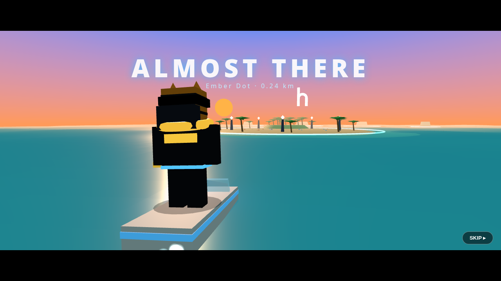

# HertzFlow Signal Wars

Third-person browser brawler set on the HertzFlow archipelago. Speedboat "Almost There" intro → fade to black → drop onto the island and fight the static invasion with power-based combat.



> ⚠️ **Unofficial fan project.** Not affiliated with, endorsed by, or sponsored by HertzFlow. No wallet, no tokens, no real money — ever. Logos/PFPs belong to their owners.

## Play locally
```bash
git clone https://github.com/defiprince-bit/signal-wars.git
cd signal-wars
npm start            # http://localhost:8080
```
No install step — the server has zero dependencies (Node 18+). Alt: `cd public && python3 -m http.server 8080`.

**Controls:** WASD move · ←→ or drag to turn camera · Q Wave · E Chain · R Roar · Space Dodge (on-screen buttons on mobile).

## Deploy
- **Railway / Render / Fly.io:** start command `npm start` (uses `$PORT`).
- **Vercel / Netlify / GitHub Pages:** publish directory `public`, no build.
See [server/README.md](server/README.md).

## Structure
```
public/   game (index.html, style.css, game.js, vendor/three.module.js)
server/   tiny Node static server
docs/     DESIGN, GAMEPLAY, CHARACTERS, screenshots
```

## Roadmap
1. Replace block stand-ins with real character models/animations (from creator's character videos)
2. Readable weapons + juicy hit FX, per-character power kits
3. Mission story beats per island; the Master boss on the **h**
4. Unlock progression (Hero/Bankyo/Zayn…), leaderboards, 1v1 + teams
5. Always-on hosted URL + live-stream hooks

Docs: [DESIGN](docs/DESIGN.md) · [GAMEPLAY](docs/GAMEPLAY.md) · [CHARACTERS](docs/CHARACTERS.md) · [CONTRIBUTING](CONTRIBUTING.md)

## License
MIT
